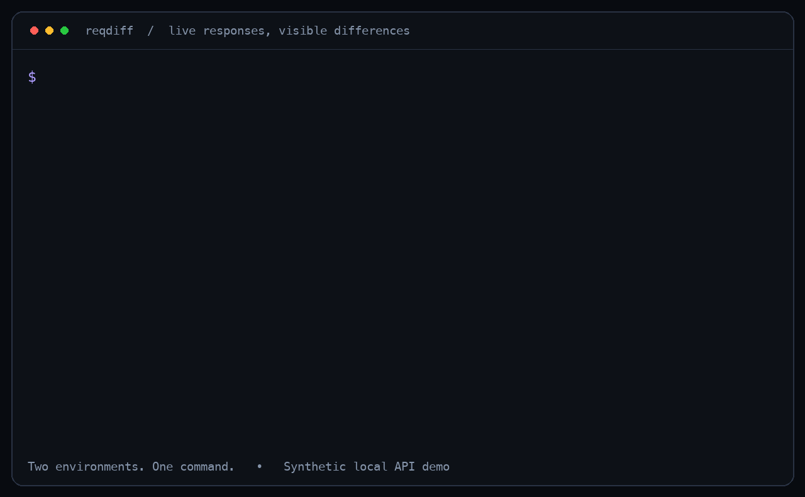

# reqdiff

[](https://github.com/yusufalper/reqdiff/actions/workflows/ci.yml)
[](https://github.com/yusufalper/reqdiff/releases/latest)

**Your API changed. Find out what actually changed.**

Compare live API responses across environments in one command. See added fields,
missing fields, type changes, headers, and latency — without an OpenAPI file.



```sh
reqdiff https://staging.example.com/users https://api.example.com/users
```

```text
Status: 200 → 200
Latency: 84ms → 210ms (+126ms)

JSON differences:
+ /user/avatar: string
~ /user/id: number → string
- /user/username: string

Result: different
```

The example and GIF use synthetic data. Timing is one request per environment,
not a benchmark.

## Why reqdiff?

A deployment can keep returning `200` and still remove a field your client needs.
reqdiff sends a real GET to each environment and shows the difference.

- **Compare shape or values.** Catch removed fields and type changes, or check exact data.
- **Ignore the noise.** Skip timestamps and generated IDs while keeping type checks.
- **Use separate credentials.** Each environment gets its own token, Basic Auth, API key, or cookie.
- **Run it in CI.** Structured JSON and predictable exit codes.
- **Keep it small.** One Go binary. No runtime dependencies. No account required.

Tools such as oasdiff compare OpenAPI contracts. reqdiff compares the responses
that two endpoints actually return. These checks answer different questions.

## Quick start

Download a binary for your OS and CPU from the [latest release](https://github.com/yusufalper/reqdiff/releases/latest), extract it, and put `reqdiff` on your PATH. Each release includes SHA-256 checksums.

Or install with Go:

```sh
go install github.com/yusufalper/reqdiff/cmd/reqdiff@v0.1.0
```

To build with Docker or from source, start with a checkout:

```sh
git clone https://github.com/yusufalper/reqdiff.git
cd reqdiff
```

### Docker — no local Go installation

```sh
docker build -t reqdiff:local .
docker run --rm reqdiff:local \
  https://staging.example.com/users https://api.example.com/users
```

The runtime image runs as a non-root user and includes CA certificates for HTTPS.
It contains no shell. To access an API running on your host from Docker Desktop,
use `host.docker.internal` rather than `localhost`.
On Linux Engine, add `--add-host=host.docker.internal:host-gateway` if needed.

### Go

Requires Go 1.26 or newer.

```sh
go build -trimpath -o reqdiff ./cmd/reqdiff
./reqdiff --help
./reqdiff https://staging.example.com/users https://api.example.com/users
```

Examples below use `reqdiff` on your PATH. Use `./reqdiff` if running the local build.
Flags work before or after the URLs.

## Try it without an API account

The local demo serves two synthetic environments with a removed username,
an added avatar, and an ID that changed from number to string.

```sh
# Terminal 1 (Python 3, standard library only)
python3 scripts/demo.py

# Terminal 2, after the Go build
./reqdiff http://127.0.0.1:8787/staging/users \
          http://127.0.0.1:8787/production/users
```

Or compare the demo from Docker Desktop:

```sh
docker run --rm reqdiff:local \
  http://host.docker.internal:8787/staging/users \
  http://host.docker.internal:8787/production/users
```

`different` exits with code `1`. That is an expected result in this demo.

## Real-world scenarios

### Check a deployment's response shape

```sh
reqdiff https://staging.example.com/users/42 https://api.example.com/users/42
```

The default `structure` mode compares field presence, types, array length, and
structures at matching array indexes. Primitive values can differ.
Object key order does not matter.

### Compare data while ignoring generated values

```sh
reqdiff https://staging.example.com/users https://api.example.com/users \
  --mode values \
  --ignore /request_id \
  --ignore-value /updated_at \
  --ignore-value '/users/*/id'
```

`--ignore` removes a field and its entire subtree from the comparison.
`--ignore-value` keeps checking presence and type, but ignores primitive values.
An ID changing from `42` to `43` can be ignored while `42` becoming `"42"` is caught.

Paths use JSON Pointer: `/user/id`, not `$.user.id`. A full `*` segment matches
any object key or array index. Quote wildcard paths in your shell.

### Compare authenticated environments

Pass the **name** of an environment variable, not the secret itself:

```sh
# Populate these through your shell, secret manager, or CI secrets.
reqdiff https://staging.example.com/users/me https://api.example.com/users/me \
  --left-bearer-env STAGING_TOKEN \
  --right-bearer-env PROD_TOKEN
```

Different auth methods can be used on each side:

```sh
reqdiff https://staging.example.com/users/me https://api.example.com/users/me \
  --left-basic-user-env STAGING_USER \
  --left-basic-password-env STAGING_PASSWORD \
  --right-header-env 'X-API-Key=PROD_API_KEY'
```

For an existing session, use `--left-cookie-env STAGING_COOKIE` and
`--right-cookie-env PROD_COOKIE`. Values should contain the Cookie header, such
as `session=...`. reqdiff does not log in or refresh sessions for you.
An email can be a Basic Auth username; an email/password JSON login endpoint is
a separate flow and is not supported in v0.1.

For Docker, forward the variables by name:

```sh
docker run --rm -e STAGING_TOKEN -e PROD_TOKEN reqdiff:local \
  https://staging.example.com/users/me https://api.example.com/users/me \
  --left-bearer-env STAGING_TOKEN --right-bearer-env PROD_TOKEN
```

Use equivalent accounts and resources. Comparing different users can produce
valid differences that have nothing to do with the deployment.

### Check headers and a latency budget

```sh
reqdiff https://staging.example.com/health https://api.example.com/health \
  --compare-header Content-Type \
  --compare-header Cache-Control \
  --max-latency-regression 150ms
```

Only `Content-Type` is compared by default. Providing `--compare-header` replaces
that default list. Latency is informational unless a threshold is set. The
threshold fails only when the **right** endpoint is slower than the left by
**more than** the given duration.

### Save a reusable comparison

See [examples/reqdiff.json](examples/reqdiff.json). Secrets stay in environment
variables; the config contains their names.

```sh
reqdiff --config examples/reqdiff.json
reqdiff --config examples/reqdiff.json --mode structure --format json
```

Docker can mount a config read-only:

```sh
docker run --rm -e STAGING_TOKEN -e PROD_TOKEN \
  -v "$PWD/examples/reqdiff.json:/config.json:ro" reqdiff:local \
  --config /config.json
```

There is no automatic config or `.env` discovery. CLI options override config;
[the reference](docs/reference.md) explains list and auth replacement rules.

### Gate a CI job

```sh
reqdiff https://staging.example.com/users https://api.example.com/users \
  --left-bearer-env STAGING_TOKEN --right-bearer-env PROD_TOKEN \
  --format json > comparison.json
```

| Exit | Meaning |
|---|---|
| `0` | No differences under the selected rules |
| `1` | Differences, or a latency threshold exceeded |
| `2` | Invalid input, auth setup, network, size limit, or JSON error |
| `130` | Comparison cancelled |

JSON output uses `schema_version: 1`. Usage errors also produce one JSON report
when `--format json` is requested. A difference makes the command fail a normal
CI step; preserve `comparison.json` as an artifact to inspect it.

## Know what you're comparing

- **Live samples, not a contract.** One response cannot prove every possible response is compatible.
- **Arrays match by index.** Order matters in `values` mode. No key-based matching or sorting.
- **Equal errors are still errors from your API.** Two identical `401` responses can compare equal; reqdiff prints warnings for HTTP error statuses.
- **GET and JSON only.** Empty bodies are supported. Non-empty HTML or plain text returns a parse error. Redirects are reported without being followed.
- **Numbers stay exact.** `1`, `1.0`, and `1e0` compare equal; large integers do not lose precision.
- **Bounded requests.** Default timeout is 10 seconds; default decompressed body limit is 10 MiB per endpoint. JSON nesting and numeric size are also limited.

## Credentials and output

Use HTTPS with credentials. URL userinfo is rejected; URL query strings are omitted
from reports. Supply secrets via the auth flags or `--*-header-env`.
Known credential strings are masked in both output formats. Raw bodies and request
headers are never dumped. `values` mode can still display other personal or
sensitive response data — automatic PII detection is not provided.

TLS verification stays enabled. Redirects are not followed. There are no
application-level retries. Standard Go proxy environment variables are respected;
make sure your proxy is appropriate for the credentials you send.

## Development

```sh
# Everything needed for tests is inside the image
docker build --target test -t reqdiff:test .

# Or with Go
make test     # includes the race detector
make vet
make build
```

Tests use local HTTP/TLS servers and synthetic data. No production endpoints or
real credentials are needed. See [CONTRIBUTING.md](CONTRIBUTING.md) for details,
and [docs/reference.md](docs/reference.md) for the full CLI and output contract.

`make release VERSION=v0.1.0` produces Linux, macOS, and Windows archives for
amd64 and arm64, plus SHA-256 checksums in `dist/`. A tag matching `v*` triggers
the included GitHub release workflow.

Licensed under [MIT](LICENSE).
